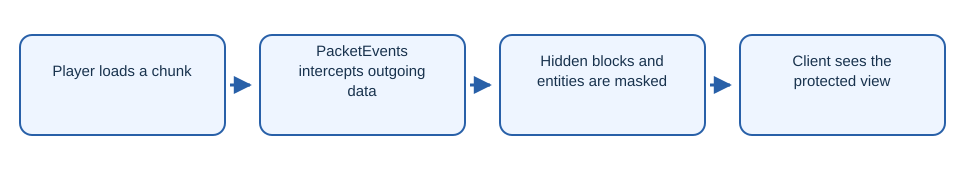

# NeonAntiFreecam

Fork of FPAntiFreeCam that hides underground blocks and entities from freecam views.

## Workflow

1. Player loads a chunk.
2. PacketEvents intercepts outgoing data.
3. Hidden blocks and entities are masked.
4. Client sees the protected view.

## Getting started

Install PacketEvents and the built plugin JAR on a compatible server. This fork derives from FPAntiFreeCam by Fleoxzyy; retain the upstream license and attribution.

## Origin

This repository is a fork of FPAntiFreeCam by Fleoxzyy. The original MIT license and attribution remain in [LICENSE](LICENSE).
